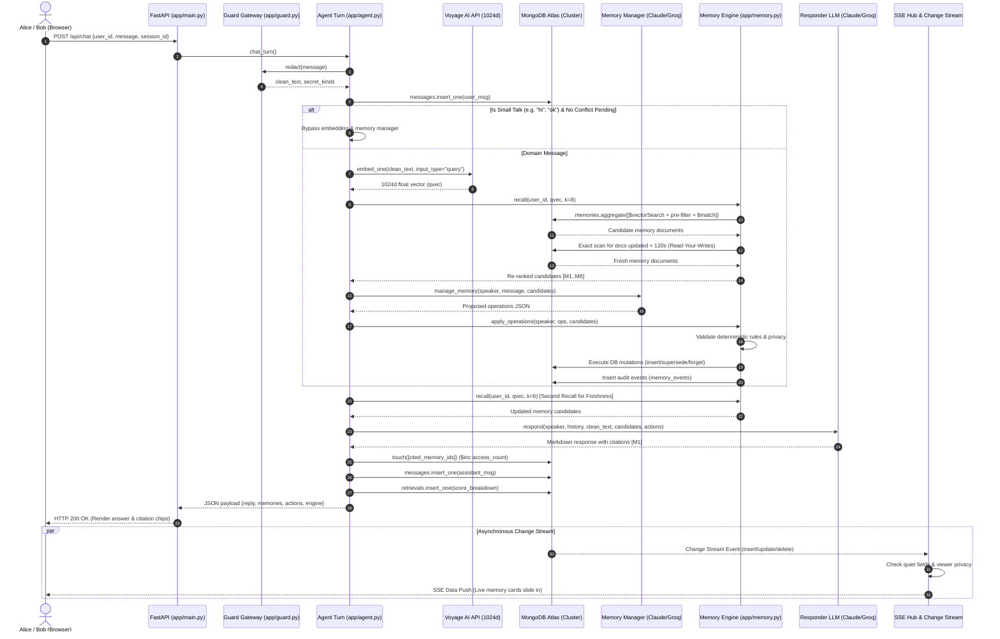
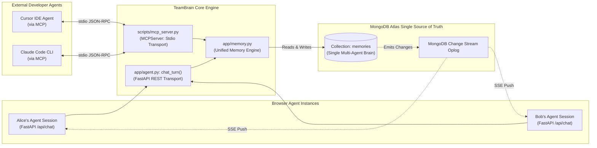

# 02. System Architecture: TeamBrain

---

## 1. High-Level Architecture Overview

TeamBrain is structured as a modern, decoupled client-server architecture centered around **MongoDB Atlas** as the multi-model data backbone, combined with **Voyage AI** for vector embeddings and multi-provider **LLMs** for reasoning.

```mermaid
flowchart TB
    subgraph Clients["Client & Agent Access Layer"]
        WebAlice["Alice UI (Web Client)<br/>Role: Backend Lead"]
        WebBob["Bob UI (Web Client)<br/>Role: Frontend Dev"]
        ClaudeCode["Claude Code / Cursor IDE<br/>(External CLI / IDE Agent)"]
    end

    subgraph InterfaceProtocols["Transport & Protocol Layer"]
        HTTPRest["HTTP/1.1 REST API<br/>(/api/chat, /api/memories)"]
        SSEStream["Server-Sent Events (SSE)<br/>(/api/stream, /api/events)"]
        MCPStdio["Model Context Protocol (MCP)<br/>(JSON-RPC via stdio)"]
    end

    subgraph BackendCore["FastAPI Backend Application (app/)"]
        Router["FastAPI Application (main.py)"]
        SecurityGateway["Security & Secret Redaction (guard.py)"]
        AgentOrchestrator["Chat & Turn Orchestrator (agent.py)"]
        MemoryEngine["Memory Engine & Safety Rules (memory.py)"]
        SSEHub["Async In-Memory Hub (main.py: Hub)"]
        ChangeWatcher["Change Stream Watcher Task (main.py: watch_memories)"]
    end

    subgraph AIServices["External AI & Embedding Providers"]
        VoyageAI["Voyage AI API (embeddings.py)<br/>Model: voyage-3.5 (1024d)"]
        LLMManager["Memory Manager LLM (llm.py)<br/>Claude Haiku 5.5 / Groq GPT-OSS 20b"]
        LLMResponder["Responder LLM (llm.py)<br/>Claude Opus 5.5 / Groq GPT-OSS 120b"]
    end

    subgraph MongoAtlas["MongoDB Atlas Database Layer (db.py)"]
        CollMemories[("memories<br/>(Vectors, Docs, Lifecycle)")]
        CollEvents[("memory_events<br/>(Immutable Audit Trail)")]
        CollMessages[("messages<br/>(Session Transcripts)")]
        CollRetrievals[("retrievals<br/>(Scoring & Citation Logs)")]
        
        AtlasHNSW["Atlas Vector Search Index<br/>(Cosine, 1024d, Pre-filters)"]
        TTLWorker["MongoDB TTL Background Worker<br/>(expireAt, 60s monitor)"]
        OplogWatcher["MongoDB Replica Set Oplog<br/>(Change Streams)"]
    end

    %% Client to Interface
    WebAlice -->|REST / JSON| HTTPRest
    WebBob -->|REST / JSON| HTTPRest
    WebAlice -.->|Listen SSE| SSEStream
    WebBob -.->|Listen SSE| SSEStream
    ClaudeCode <-->|stdio JSON-RPC| MCPStdio

    %% Interface to Backend
    HTTPRest --> Router
    Router --> SecurityGateway
    SecurityGateway --> AgentOrchestrator
    AgentOrchestrator --> MemoryEngine
    SSEStream <--> SSEHub
    MCPStdio <-->|Direct Python imports| MemoryEngine

    %% Backend to AI
    MemoryEngine -->|embed_one()| VoyageAI
    AgentOrchestrator -->|manage_memory()| LLMManager
    AgentOrchestrator -->|respond()| LLMResponder

    %% Backend to Database
    MemoryEngine -->|Aggregate $vectorSearch| AtlasHNSW
    AtlasHNSW --- CollMemories
    MemoryEngine -->|Write mutations| CollMemories
    MemoryEngine -->|Append audit| CollEvents
    AgentOrchestrator -->|Store chat| CollMessages
    AgentOrchestrator -->|Store score diagnostics| CollRetrievals
    CollMemories --- TTLWorker

    %% Change Stream Flow
    CollMemories -.->|Database Mutations| OplogWatcher
    OplogWatcher -.->|Async Stream| ChangeWatcher
    ChangeWatcher -->|dispatch()| SSEHub
```

---

## 2. Component Breakdown & Responsibilities

### 2.1 The Client Layer
- **Web Frontend (`static/index.html`, `static/app.js`, `static/style.css`)**:
  - Implements a dual-chat pane allowing simultaneous testing of Alice's persona and Bob's persona.
  - Maintains a real-time reactive **Team Memory Panel** that displays cards color-coded by memory type (`decision`, `constraint`, `preference`, etc.), version badges (`v1`, `v2`), and real-time countdown progress bars for TTL-expiring memories.
  - Connects to `/api/stream` via the browser's native `EventSource` API.
  - Contains an interactive **Memory Inspector** drawer that fetches deep provenance: source quotes, full version lineages, and append-only audit events.
- **External Coding Agents (`scripts/mcp_server.py`)**:
  - Implements the open **Model Context Protocol (MCP)** specification over standard I/O (stdio).
  - Exposes tools: `recall_team_memory`, `remember`, and `forget_memory`.
  - Enables autonomous developer agents (like Anthropic’s Claude Code CLI or Cursor) to automatically pull and push to the exact same MongoDB collection without using a web browser.

### 2.2 The FastAPI Backend Core
- **Application Entry Point (`app/main.py`)**:
  - Initializes FastAPI, configures CORS, mounts static assets, and manages application lifecycle hooks (`lifespan`).
  - Implements REST endpoints for chat submissions, session history, memory CRUD operations, thumbs-down feedback capture, and system reset/seeding.
  - Hosts the `Hub` class: an asynchronous, in-memory Server-Sent Events broker.
- **Security & Preprocessing Gateway (`app/guard.py`)**:
  - Intercepts all raw user text before it touches LLMs or database records.
  - Executes deterministic regular-expression scanning to redact private keys, API keys, database credentials, passwords, and credit card numbers (verified via the Luhn algorithm).
  - Inspects text for prompt-injection markers and defamatory personal claims regarding teammates.
- **Agent Orchestrator (`app/agent.py`)**:
  - Coordinates the single-turn chat cycle: secret scrubbing $\rightarrow$ chat history loading $\rightarrow$ small-talk detection $\rightarrow$ first candidate recall $\rightarrow$ memory manager invocation $\rightarrow$ deterministic rule validation $\rightarrow$ database mutation execution $\rightarrow$ second candidate recall $\rightarrow$ grounded answer generation $\rightarrow$ citation extraction $\rightarrow$ access logging (`touch`).
- **Memory Engine (`app/memory.py`)**:
  - Encapsulates all interactions with MongoDB: vector search aggregation pipelines, exact cosine scans for read-your-writes freshness, scoring formula calculation, versioned superseding, soft-deletion, and audit event emission.
- **Database Connection Layer (`app/db.py`)**:
  - Manages the singleton `AsyncMongoClient` connection with timezone-aware datetime serialization, explicit collection handles, and BSON-to-JSON serialization utilities.

### 2.3 The AI & Embedding Layer
- **Embedding Client (`app/embeddings.py`)**:
  - Interfaces with Voyage AI via asynchronous HTTP requests (`httpx`).
  - Supports asymmetric embedding modes: `input_type="query"` for search queries and `input_type="document"` for memory storage.
  - Features an automated exponential-backoff retry loop and an in-memory circuit breaker (`BREAKER_S = 30s`) that automatically shifts the system to a local keyword-matching degraded fallback if external APIs fail.
- **LLM Provider Abstraction (`app/llm.py`)**:
  - Dual-provider architecture: Supports native **Anthropic** SDK (Claude 3.5 Haiku and Claude 3.5 Opus) as well as **OpenAI-Compatible** endpoints (Groq, Gemini, OpenRouter, Ollama, OpenAI).
  - Decouples reasoning: Runs a small, high-throughput model for memory extraction and a larger model with citation instructions for final chat response generation.
  - Implements an automated secondary provider fallback (`LLM_FALLBACK_PROVIDER`) for uninterrupted demos when hitting free-tier rate limits.

### 2.4 The MongoDB Atlas Layer
- **Multi-Model Database (`teambrain`)**:
  - `memories`: Stores the core memory documents containing dense 1024d float arrays, version chain pointers, lifecycle statuses, and TTL expiration dates.
  - `memory_events`: An append-only audit trail recording every state mutation (`created`, `superseded`, `conflict_flagged`, `reinforced`, `deleted`, `hard_deleted`).
  - `messages`: Stores per-session conversation transcripts.
  - `retrievals`: Comprehensive diagnostic logs recording vector search scores, similarity values, recency weights, and cited flags for every query.
- **Atlas Vector Search (`memory_vec`)**:
  - Native Lucene HNSW index operating directly on the `embedding` path with pre-filter indexed fields (`workspace_id`, `owner_id`, `scope`, `status`, `type`).
- **Atlas TTL Index (`expireAt`)**:
  - Automatically monitors document timestamps and physically deletes expired documents.
- **Change Streams**:
  - Tailable oplog cursor enabling zero-latency reactivity across multi-agent sessions.

---

## 3. Component Interaction Flow

The following diagram illustrates the exact sequence of interactions when a user submits a message:



---

## 4. Application Startup & Shutdown Lifecycle

FastAPI’s modern `lifespan` context manager handles orderly bootstrap and teardown without deprecated event hooks:

```mermaid
flowchart TD
    Start([Application Start / Uvicorn Launch]) --> InitDriver[Initialize AsyncMongoClient in app/db.py]
    InitDriver --> LifespanStart[FastAPI lifespan() Triggered]
    
    subgraph StartupSequence["Idempotent Database Initialization (app/setup.py)"]
        LifespanStart --> EnsureColls["ensure_collections()<br/>Create collections with $jsonSchema validator"]
        EnsureColls --> EnsureIdx["ensure_indexes()<br/>Create TTL index, B-tree query & audit indexes"]
        EnsureIdx --> SpawnWatcher["asyncio.create_task(watch_memories())<br/>Launch persistent background change stream task"]
    end

    SpawnWatcher --> ServerReady([Server Ready: Listening on 0.0.0.0:8000])

    ServerReady --> RunningState{Server Operating}
    RunningState -->|Incoming Requests| ProcessRequests[Process REST & SSE Connections]
    RunningState -->|SIGTERM / SIGINT| ShutdownSignal[Shutdown Signal Received]

    subgraph ShutdownSequence["Graceful Teardown"]
        ShutdownSignal --> CancelTask[Cancel watch_memories() background task]
        CancelTask --> CloseQueues[Drain and close client SSE queues]
        CloseQueues --> CloseMongoClient[Close AsyncMongoClient connection pool]
    end

    CloseMongoClient --> Terminate([Application Process Terminated Cleanly])
```

### Startup Guarantees
1. **Schema Validation Enforcement**: `ensure_collections()` executes `collMod` to ensure the `$jsonSchema` validator is attached to the `memories` collection.
2. **Index Verification**: `ensure_indexes()` builds the TTL index `ttl_expireAt` and compound query indexes.
3. **Change Stream Resilience**: `watch_memories()` runs in a continuous loop. If network turbulence interrupts the change stream, it captures the exception, logs a warning, waits 3 seconds, and reconnects using the latest `resume_token`.

---

## 5. Multi-Agent Communication & MCP Architecture

TeamBrain bridges internal web-based agents and external CLI/IDE agents through a unified storage model:



### Architectural Properties of the Multi-Agent Design:
1. **Zero Divergence**: There are no separate schemas or caches for external MCP agents versus internal web agents. Both call `app/memory.py` functions directly.
2. **Immediate Visibility**: When Claude Code executes `remember(content="We use pnpm")` inside an engineer's terminal, a MongoDB document is inserted. Milliseconds later, the Change Stream triggers, and Bob's browser dashboard renders the new memory card with no page reload.
3. **Binding Team Constraints**: When Cursor asks `recall_team_memory("configure payment limits")`, it retrieves constraints formulated by Alice's web chat an hour earlier, automatically preventing code generation drift.

---

## 6. Document Navigation

- Previous Document: [01. Project Overview](01-project-overview.md)
- Next Document: [03. Memory Data Model](03-memory-data-model.md)
- Complete Index: [Table of Contents](../README.md#documentation-index)

