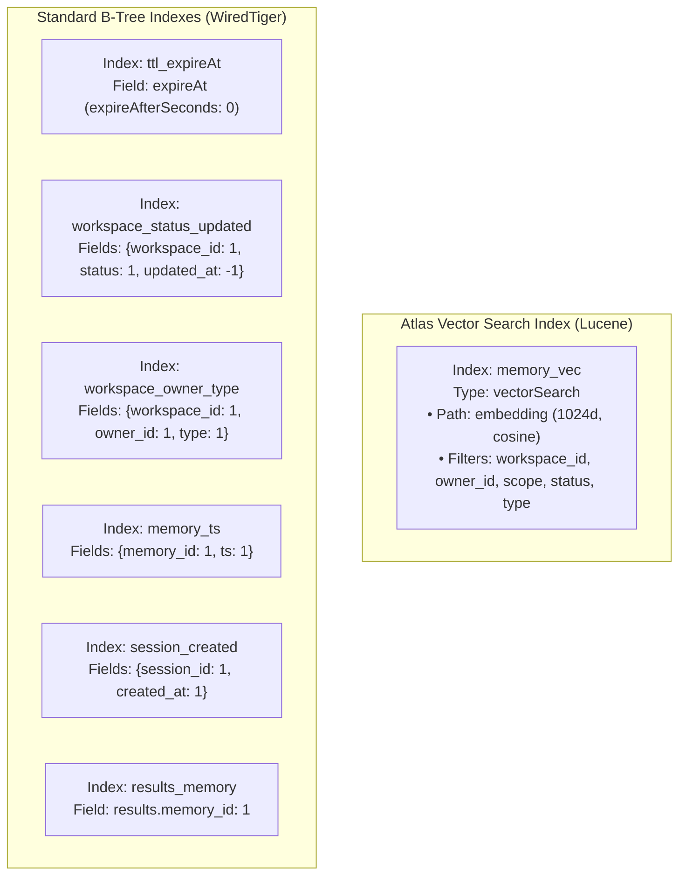

# 03. Memory Data Model & MongoDB Storage Architecture

---

## 1. Storage Rationale: Why MongoDB?

A critical engineering decision in TeamBrain is using **MongoDB Atlas** as the unified persistence and retrieval engine, rather than stitching together a traditional relational database (e.g., PostgreSQL) with an external standalone vector database (e.g., Pinecone, Milvus, or Qdrant).

### 1.1 The Polymorphic Document Advantage
In an agentic memory system, memory entries are inherently non-uniform:
- A `decision` memory links to prior version documents (`supersedes`, `superseded_by`).
- An `outcome` memory holds diagnostic test metrics or incident links.
- A transient infrastructure notice holds an expiration timestamp (`expireAt`).
- A `feedback` memory references specific chat messages and user feedback ratings.

In a relational model, representing this requires either sprawling multi-table joins across dozens of foreign keys or dumping arbitrary unstructured data into un-indexed JSONB blobs. In MongoDB, a memory is **a single self-contained BSON document**. Vector embeddings, textual content, lifecycle state, provenance, and temporal expiration criteria co-exist in one locality of reference.

### 1.2 Eliminating the "Dual-Database" Distributed Systems Trap
When systems separate metadata storage (SQL) from vector storage (Specialized Vector DB):
1. **Distributed Two-Phase Writes**: An insert must succeed in both databases. If the vector database succeeds but SQL fails, or vice-versa, the system suffers from ghost embeddings or orphaned records.
2. **Two-Stage Filtering Latency**: Traditional RAG must either:
   - Perform vector search first, retrieve 100 candidate IDs, and issue an expensive `WHERE id IN (...)` SQL query (which fails if all 100 IDs belong to other tenants), or
   - Query SQL for tenant IDs first, and pass tens of thousands of IDs into the vector database filter.
3. **Atlas Vector Search Solution**: With MongoDB Atlas Vector Search, **the vector and the metadata reside in the exact same collection**. The `$vectorSearch` operator applies metadata pre-filters (`workspace_id`, `owner_id`, `status`) *inside the Lucene index search stage before vector ranking*, guaranteeing zero privacy leakage and single-hop execution.

---

## 2. Comprehensive Collection Specifications

TeamBrain organizes its domain across four dedicated collections in the `teambrain` database:

```
                    +---------------------------------------+
                    |             teambrain DB              |
                    +---------------------------------------+
                                        |
        +-------------------+-----------+-----------+-------------------+
        |                   |                       |                   |
        v                   v                       v                   v
+---------------+   +-------------------+   +---------------+   +---------------+
|   memories    |   |   memory_events   |   |   messages    |   |  retrievals   |
| (Core Memory  |   | (Immutable Audit  |   | (Session Chat |   | (Diagnostic   |
|  & Vectors)   |   |    Log Trail)     |   |  Transcripts) |   |  Scoring Log) |
+---------------+   +-------------------+   +---------------+   +---------------+
```

---

## 3. The `memories` Collection

The `memories` collection is the primary store for long-term agent knowledge.

### 3.1 Schema Definition & Field Breakdown

| Field | BSON Type | Nullable | Required | Purpose / Constraints |
|---|---|---|---|---|
| `_id` | `ObjectId` | No | Auto | Unique identifier for the memory document. |
| `workspace_id` | `string` | No | Yes | Tenant isolation key (e.g., `"phoenix"`). Enforced in all queries. |
| `owner_id` | `string` | No | Yes | User who originated the memory (e.g., `"alice"`, `"bob"`). |
| `scope` | `string` | No | Yes | Access tier: `"workspace"` (team-shared) or `"private"` (owner-only). |
| `type` | `string` | No | Yes | Category: `fact`, `preference`, `decision`, `constraint`, `outcome`, `feedback`, `strategy`. |
| `content` | `string` | No | Yes | Normalized, 3rd-person declarative English text (min length: 1). |
| `embedding` | `array` | No | Yes | 1024-dimensional dense float vector generated by Voyage AI (`voyage-3.5`). |
| `source` | `object` | No | Yes | Provenance metadata: `{ kind: "chat"|"manual"|"seed"|"mcp", session_id, message_id, quote }`. |
| `importance` | `double` | No | Yes | Subjective relevance weight assigned by LLM $\in [0.0, 1.0]$. |
| `confidence` | `double` | No | Yes | Belief certainty metric $\in [0.0, 1.0]$ (defaults to `0.9`, bumped by `reinforce`). |
| `status` | `string` | No | Yes | Lifecycle state: `"active"`, `"superseded"`, or `"deleted"`. |
| `version` | `int` | No | Yes | Sequential revision counter (starts at `1`, increments on `supersede`). |
| `supersedes` | `ObjectId` | Yes | No | Pointer to the previous version document that this memory corrected. |
| `superseded_by` | `ObjectId` | Yes | No | Pointer to the newer revision document that replaced this memory. |
| `access_count` | `int` | No | Yes | Counter tracking how many times this memory was cited in responses. |
| `reinforced_count`| `int` | No | Yes | Counter tracking how many times teammates restated this fact. |
| `created_at` | `date` | No | Yes | UTC timestamp of memory insertion. |
| `updated_at` | `date` | No | Yes | UTC timestamp of most recent mutation or revision. |
| `last_accessed_at`| `date` | Yes | No | UTC timestamp when this memory was last cited in an answer. |
| `last_confirmed_at`| `date`| Yes | No | UTC timestamp when a reinforce operation reaffirmed this memory. |
| `expireAt` | `date` | Yes | No | Expiration timestamp monitored by MongoDB TTL index. Null if permanent. |
| `deleted_by` | `string` | Yes | No | User ID who soft-deleted this memory. |
| `deleted_at` | `date` | Yes | No | UTC timestamp when soft-deletion occurred. |

### 3.2 MongoDB Collection-Level `$jsonSchema` Validation

Enforced on collection creation in `app/setup.py`:

```json
{
  "$jsonSchema": {
    "bsonType": "object",
    "required": [
      "workspace_id", "owner_id", "scope", "type", 
      "content", "status", "created_at", "updated_at"
    ],
    "properties": {
      "workspace_id": { "bsonType": "string" },
      "owner_id": { "bsonType": "string" },
      "scope": { "enum": ["workspace", "private"] },
      "type": { 
        "enum": ["fact", "preference", "decision", "constraint", "outcome", "feedback", "strategy"] 
      },
      "content": { "bsonType": "string", "minLength": 1 },
      "status": { "enum": ["active", "superseded", "deleted"] },
      "importance": { "bsonType": ["double", "int"], "minimum": 0, "maximum": 1 },
      "embedding": { "bsonType": "array" },
      "version": { "bsonType": "int", "minimum": 1 },
      "created_at": { "bsonType": "date" },
      "updated_at": { "bsonType": "date" },
      "expireAt": { "bsonType": ["date", "null"] }
    }
  }
}
```

### 3.3 Synthetic Document Examples

#### Example 1: Active Team Decision with Version Lineage (v2)
```json
{
  "_id": { "$oid": "6724a1b8c9d0e1f2a3b4c502" },
  "workspace_id": "phoenix",
  "owner_id": "alice",
  "scope": "workspace",
  "type": "decision",
  "content": "The payments API rate limit was raised to 500 requests per second (stated by Alice).",
  "embedding": [ 0.0182, -0.0412, 0.0934, "... 1024 floats ..." ],
  "source": {
    "kind": "chat",
    "session_id": "alice-sess-101",
    "message_id": { "$oid": "6724a1b8c9d0e1f2a3b4c501" },
    "quote": "Update: the payments API rate limit was raised to 500 requests per second."
  },
  "importance": 0.9,
  "confidence": 0.95,
  "status": "active",
  "version": 2,
  "supersedes": { "$oid": "6724a100c9d0e1f2a3b4c401" },
  "superseded_by": null,
  "access_count": 7,
  "reinforced_count": 1,
  "created_at": { "$date": "2026-11-01T08:15:00.000Z" },
  "updated_at": { "$date": "2026-11-01T08:15:00.000Z" },
  "last_accessed_at": { "$date": "2026-11-01T08:22:15.000Z" },
  "last_confirmed_at": { "$date": "2026-11-01T08:20:00.000Z" },
  "expireAt": null
}
```

#### Example 2: Time-Bound Constraint with TTL Expiry
```json
{
  "_id": { "$oid": "6724a2c9c9d0e1f2a3b4c601" },
  "workspace_id": "phoenix",
  "owner_id": "alice",
  "scope": "workspace",
  "type": "constraint",
  "content": "Staging DB is offline for maintenance for the next 2 minutes (stated by Alice).",
  "embedding": [ -0.0211, 0.0543, 0.0129, "... 1024 floats ..." ],
  "source": {
    "kind": "chat",
    "session_id": "alice-sess-102",
    "message_id": { "$oid": "6724a2c9c9d0e1f2a3b4c600" },
    "quote": "Staging DB is down for the next 2 minutes."
  },
  "importance": 0.85,
  "confidence": 0.9,
  "status": "active",
  "version": 1,
  "supersedes": null,
  "superseded_by": null,
  "access_count": 1,
  "reinforced_count": 0,
  "created_at": { "$date": "2026-11-01T08:30:00.000Z" },
  "updated_at": { "$date": "2026-11-01T08:30:00.000Z" },
  "last_accessed_at": { "$date": "2026-11-01T08:30:45.000Z" },
  "expireAt": { "$date": "2026-11-01T08:32:00.000Z" }
}
```

#### Example 3: Private User Preference (Owner-Isolated)
```json
{
  "_id": { "$oid": "6724a350c9d0e1f2a3b4c701" },
  "workspace_id": "phoenix",
  "owner_id": "alice",
  "scope": "private",
  "type": "preference",
  "content": "Alice prefers very terse answers, bullet points only.",
  "embedding": [ 0.0451, -0.0102, -0.0388, "... 1024 floats ..." ],
  "source": {
    "kind": "chat",
    "session_id": "alice-sess-103",
    "message_id": { "$oid": "6724a350c9d0e1f2a3b4c700" },
    "quote": "I prefer very terse answers, bullet points only."
  },
  "importance": 0.5,
  "confidence": 0.9,
  "status": "active",
  "version": 1,
  "supersedes": null,
  "superseded_by": null,
  "access_count": 3,
  "reinforced_count": 0,
  "created_at": { "$date": "2026-11-01T08:40:00.000Z" },
  "updated_at": { "$date": "2026-11-01T08:40:00.000Z" },
  "last_accessed_at": { "$date": "2026-11-01T08:45:10.000Z" },
  "expireAt": null
}
```

---

## 4. The `memory_events` Collection (Audit Trail)

The `memory_events` collection is an append-only log recording every lifecycle transition across memories. It provides forensic traceability for security audits, legal compliance, and the front-end Memory Inspector history view.

### 4.1 Schema Definition
- `memory_id` (`ObjectId`): Foreign key to the subject document in `memories`.
- `workspace_id` (`string`): Workspace boundary.
- `action` (`string`): Mutation category:
  - `"created"`: New memory document added.
  - `"superseded"`: Prior version deactivated by a newer revision.
  - `"conflict_flagged"`: Contradictory assertion identified and halted.
  - `"reinforced"`: Duplicate assertion confirmed; confidence boosted.
  - `"deleted"`: Soft-deleted by user or command.
  - `"hard_deleted"`: Permanently erased under "right to be forgotten".
- `actor` (`string`): User ID who triggered the event (`"alice"`, `"bob"`, or `"system"`).
- `reason` (`string`): Explanation of why the action was taken.
- `ts` (`date`): UTC timestamp of event generation.
- Extra payload fields: `version`, `by` (successor ObjectId), `content`, `proposed_content`, `ttl_seconds`.

### 4.2 Synthetic Audit Event Document
```json
{
  "_id": { "$oid": "6724a1b8c9d0e1f2a3b4c503" },
  "memory_id": { "$oid": "6724a100c9d0e1f2a3b4c401" },
  "workspace_id": "phoenix",
  "action": "superseded",
  "actor": "alice",
  "reason": "Updates an existing memory with new rate limit",
  "ts": { "$date": "2026-11-01T08:15:00.000Z" },
  "by": { "$oid": "6724a1b8c9d0e1f2a3b4c502" },
  "new_content": "The payments API rate limit was raised to 500 requests per second (stated by Alice)."
}
```

---

## 5. The `retrievals` Collection (Diagnostic Scoring)

For every query evaluated by the memory engine, a snapshot of the candidate scoring pipeline is preserved in `retrievals`. This directly answers the judge and developer question: *"Why did the agent choose this specific memory?"*

### 5.1 Schema Definition
- `message_id` (`ObjectId`): Foreign key linking to the assistant message in `messages`.
- `session_id` (`string`): Active session token.
- `user_id` (`string`): Requesting user.
- `query` (`string`): Cleaned query text sent to vector search.
- `use_memory` (`boolean`): Whether memory context was enabled.
- `engine` (`object`): Retrieval engine utilized (`{ name: "atlas-vector-search", detail: "..." }`).
- `filter` (`object`): Exact MongoDB filter applied inside the vector search.
- `weights` (`object`): Scoring weights (`{ sim: 0.8, recency: 0.1, importance: 0.1 }`).
- `results` (`array` of objects):
  - `ref` (`string`): Tag assigned for prompting (`"M1"`, `"M2"`).
  - `memory_id` (`ObjectId`): ID of candidate document.
  - `sim` (`double`): Cosine vector similarity score.
  - `recency` (`double`): Exponential decay score.
  - `importance` (`double`): Base importance score.
  - `final` (`double`): Weighted composite score.
  - `cited` (`boolean`): Whether the responder LLM actually referenced this candidate.

---

## 6. Indexing Strategy & Performance Architecture

TeamBrain defines a deliberate indexing strategy across collections to ensure sub-100ms retrieval and background maintenance:



### Detailed Index Justification

1. **`memory_vec` (Vector Search)**:
   - Configured with `dimensions: 1024` and `similarity: "cosine"`.
   - All filter fields are indexed as `"type": "filter"` inside Lucene. This enables Atlas to prune branches before traversing the HNSW vector graph, avoiding wasted distance calculations on soft-deleted or unauthorized memories.
2. **`ttl_expireAt` (TTL Index)**:
   - Key: `{ expireAt: 1 }` with `expireAfterSeconds: 0`.
   - WiredTiger’s background thread inspects this index once every 60 seconds and deletes documents where `expireAt <= now()`.
   - Crucially, if `expireAt` is `null` or missing, the index skips the document—allowing permanent memories to live indefinitely without storage penalty.
3. **`workspace_status_updated`**:
   - Compound index optimized for the front-end memory dashboard (`GET /api/memories?status=active`).
   - Supports equality on tenant and status, and range/sort on `updated_at` without requiring in-memory sorting.
4. **`results.memory_id` (Multikey Index)**:
   - Enables the Memory Inspector to execute `retrievals.count_documents({"results.memory_id": id})` instantaneously, displaying how many times an individual memory has been recalled across the entire system.

---

## 7. Document Navigation

- Previous Document: [02. System Architecture](02-system-architecture.md)
- Next Document: [04. Memory Creation & Retrieval Pipeline](04-memory-pipeline.md)
- Complete Index: [Table of Contents](../README.md#documentation-index)

