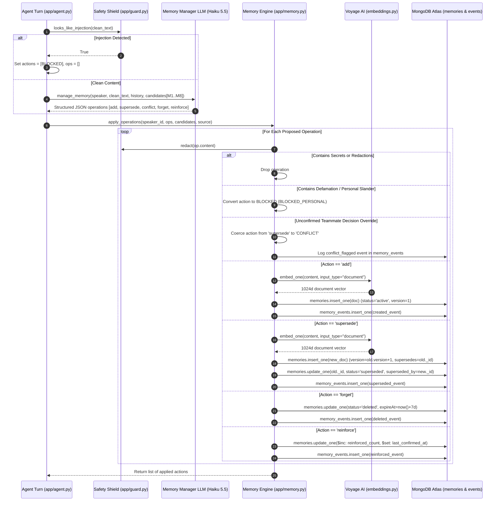

# 04. Memory Creation and Retrieval Pipeline

---

## 1. Overview & Dual-Phase Architecture

The memory engine in TeamBrain balances two synchronized operations on every conversational turn:
1. **The Retrieval Pipeline (Recall)**: Finding semantically relevant, non-expired, and privacy-authorized memories to contextualize reasoning.
2. **The Extraction & Mutation Pipeline (Remember)**: Analyzing the user's conversational intent, extracting durable assertions, reconciling with existing knowledge, and persisting changes to MongoDB Atlas.

A unique architectural choice in TeamBrain is the **Two-Phase Recall Cycle**:
- **Turn 1 Recall**: Retrieves neighbors of the user's message *before* running the Memory Manager LLM, allowing the manager to detect conflicts, duplicates, or candidates for superseding.
- **Turn 2 Recall**: Re-queries memory *after* database mutations occur, guaranteeing that memories added or superseded *in this exact turn* are grounded in the Responder LLM's final answer.

---

## 2. The Memory Retrieval Pipeline (Recall)

### 2.1 Step-by-Step Retrieval Execution

```mermaid
flowchart TD
    UserQuery([User Input Text]) --> SecretScrub[guard.redact: Strip Raw Secrets]
    SecretScrub --> SmallTalkDecision{is_small_talk?<br/>& not conflict_pending}
    
    SmallTalkDecision -->|Yes| BypassRecall[Bypass Recall: Return Empty Candidates]
    SmallTalkDecision -->|No| AsymmEmbedding[embeddings.py: embed_one<br/>input_type='query', model='voyage-3.5']
    
    AsymmEmbedding --> CircuitCheck{Voyage API OK?}
    CircuitCheck -->|Error / Breaker Open| KeywordFallback[app/memory.py: keyword_recall<br/>In-App Word Tokenization & Overlap<br/>Read-Only Mode]
    CircuitCheck -->|Success| AtlasVectorPipeline[MongoDB Atlas Aggregation Pipeline<br/>Collection: memories]

    subgraph AtlasPipeline["Atlas Aggregation: memories.aggregate()"]
        AtlasVectorPipeline --> StageVectorSearch["$vectorSearch Stage<br/>• index: 'memory_vec'<br/>• queryVector: qvec (1024d)<br/>• numCandidates: max(100, k*20)<br/>• limit: k*3<br/>• filter: workspace_id & status='active'<br/>  & (scope='workspace' OR owner_id=user)"]
        StageVectorSearch --> StageAddFields["$addFields Stage<br/>sim = $meta: 'vectorSearchScore'"]
        StageAddFields --> StageMatch["$match Stage (Eventual Consistency Protection)<br/>• re-verify workspace_id & status='active'<br/>• filter: expireAt > now() OR expireAt null"]
        StageMatch --> StageProject["$project Stage<br/>embedding: 0 (strip 1024 floats)"]
    end

    StageProject --> ReadYourWritesScan["Read-Your-Writes Exact Scan (app/memory.py)<br/>Scan memories where updated_at >= now() - 120s<br/>Merge fresh un-indexed docs into candidates"]
    
    ReadYourWritesScan --> ReRankingEngine["Hybrid Re-Ranking Engine (_score)<br/>Score = 0.8·sim + 0.1·recency + 0.1·importance<br/>recency = 0.5^(age / half_life[type])"]
    
    ReRankingEngine --> SimCutoff{"Filter: sim >= MIN_SIM<br/>(0.55 Voyage / 0.52 Fake)"}
    SimCutoff -->|Pass| SortTopK[Sort by Final Score Descending<br/>Slice Top-K (k=8 manager, k=6 chat)]
    SimCutoff -->|Fail| DiscardNoise[Discard Irrelevant Noise]

    SortTopK --> LabelRefs[Assign Canonical Prompt References<br/>M1, M2, M3, ... Mk]
    LabelRefs --> ContextReady([Context Ready for LLM Consumption])
```

---

### 2.2 Deep Dive: The Mathematical Re-Ranking Formula

Traditional RAG relies solely on cosine similarity:
$$\text{sim} = \frac{\mathbf{u} \cdot \mathbf{v}}{\|\mathbf{u}\|_2 \|\mathbf{v}\|_2}$$

While cosine similarity measures semantic proximity, in a software engineering team it suffers from severe failure modes:
- A stale rate limit stated 6 months ago may have a $0.88$ similarity score.
- A critical update stated 5 minutes ago may have a $0.85$ similarity score.
- Relying solely on similarity causes the agent to follow the outdated instruction.

TeamBrain implements a composite re-ranking formula configured in `app/config.py` and calculated in `app/memory.py`:

$$\text{Final Score} = w_{\text{sim}} \cdot \text{sim} + w_{\text{recency}} \cdot \text{recency} + w_{\text{importance}} \cdot \text{importance}$$

Where the tuned production weights are:
$$w_{\text{sim}} = 0.8, \quad w_{\text{recency}} = 0.1, \quad w_{\text{importance}} = 0.1$$

#### 1. Normalized Vector Similarity ($\text{sim}$)
Atlas Vector Search normalizes cosine distance into a score between $0.0$ and $1.0$, where $0.5$ represents orthogonal vectors. Memories with $\text{sim} < 0.55$ (`MIN_SIM`) are rejected as irrelevant noise.

#### 2. Category-Specific Exponential Half-Life Decay ($\text{recency}$)
Recency is evaluated using continuous exponential half-life decay:

$$\text{recency} = 0.5^{\left(\frac{\text{age\_seconds}}{\text{half\_life\_seconds}}\right)}$$

Where $\text{age\_seconds} = \max(0, \text{now}() - \text{updated\_at})$. 

Crucially, **different memory types decay at different velocities**, configured via `HALF_LIFE_DAYS` in `app/config.py`:

| Memory Type | Half-Life ($t_{1/2}$) | Architectural Rationale |
|---|---|---|
| `fact` | 30 days | Environmental and operational facts change moderately fast. |
| `outcome` | 30 days | Incident reports and performance test numbers are situational. |
| `constraint` | 45 days | Deadlines and rate limits last several sprint cycles. |
| `decision` | 90 days | Architectural choices (e.g. choice of package manager) are durable. |
| `preference` | 120 days | Developer personal preferences (e.g. terse code style) persist long-term. |
| `feedback` | 120 days | Correction feedback on agent answers remains relevant across quarters. |
| `strategy` | 120 days | High-level engineering guidelines and design patterns rarely change. |

#### 3. Importance Weight ($\text{importance}$)
A scalar value between $0.0$ and $1.0$. Decisions and constraints that impact teammates are initialized at $0.8\text{--}1.0$, while minor personal preferences default to $0.3\text{--}0.6$.

---

### 2.3 Read-Your-Writes Consistency Architecture

Atlas Vector Search indexes update asynchronously in the background. If Alice saves an architectural decision, and Bob queries the system 2 seconds later, the new document might not yet be indexed in Lucene's HNSW graph.

TeamBrain eliminates this consistency lag in `_vector_candidates()`:
```python
# app/memory.py
# 1. Fetch search index candidates from Atlas Vector Search
docs = await (await memories.aggregate(pipeline)).to_list()

# 2. Read-your-writes window: Fetch docs modified in the last 120 seconds
seen = {d["_id"] for d in docs}
fresh = await _exact_scan(
    user_id, qvec, {"updated_at": {"$gte": now() - timedelta(seconds=FRESH_WINDOW_S)}}
)

# 3. Merge fresh unindexed documents into candidate pool
docs += [d for d in fresh if d["_id"] not in seen]
docs.sort(key=lambda d: d["sim"], reverse=True)
```
This guarantees strict **read-your-writes consistency** without waiting for index sync cycles.

---

## 3. The Memory Creation & Management Pipeline (Remember)

### 3.1 Step-by-Step Creation Sequence



---

## 4. Grounded Response Generation & Citations

Once memory mutations are finalized, Stage 7 produces the user-facing response:

1. **Second Candidate Recall**:
   ```python
   recalled = await recall(user_id, qvec) if qvec is not None else no_recall
   ```
   If Alice just submitted *"Payments rate limit is 500 req/s"*, the second recall immediately pulls this brand-new memory as `[M1]`.

2. **Context Formatting in Responder Prompt**:
   - `render_memories()` formats candidates with provenance:
     ```
     [M1] (decision, workspace, by Alice, saved from this message) The payments API rate limit was raised to 500 requests per second.
     [M2] (strategy, workspace, by Bob, 4 days ago) When payments sandbox returns 429, retry with backoff.
     ```
   - `render_actions()` explicitly tells the responder what happened in the database:
     ```
     - UPDATED memory: "Payments rate limit is 100 req/s" -> "Payments rate limit is 500 req/s"
     ```

3. **Citation Normalization Engine**:
   LLMs cite memories inconsistently: some write `(M1)`, others write `【M1】`, `[M1, M2]`, or `M1 to M3`.
   `app/agent.py` uses regex normalization:
   ```python
   CITE_GROUP = re.compile(r"[\[(【]\s*(M\d+(?:\s*(?:[,;]|[-–—]|to)\s*M\d+)*)\s*[\])】]")
   reply = CITE_GROUP.sub(lambda m: _expand_refs(m.group(1)), reply)
   ```
   This normalizes all variations into canonical, clickable chips: `[M1][M2]`.

4. **Access Touch Accounting**:
   The engine scans the final markdown string for cited references (`[M1]`). For every memory actually cited in the generated answer, MongoDB issues an atomic `$inc` update:
   ```python
   await memories.update_many(
       {"_id": {"$in": cited_memory_ids}},
       {"$set": {"last_accessed_at": now()}, "$inc": {"access_count": 1}}
   )
   ```
   This completes the feedback loop: useful memories accumulate higher access counts, while un-cited memories naturally fade through recency decay.

---

## 5. Document Navigation

- Previous Document: [03. Memory Data Model](03-memory-data-model.md)
- Next Document: [05. Memory Lifecycle & Advanced Cases](05-memory-lifecycle.md)
- Complete Index: [Table of Contents](../README.md#documentation-index)

