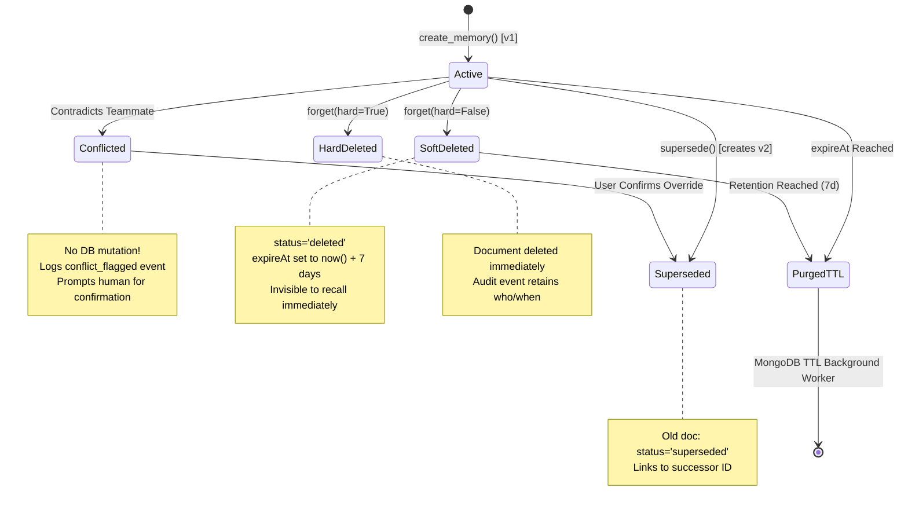

# 05. Memory Lifecycle and Advanced Edge Cases

---

## 1. Overview of Lifecycle States

A memory in TeamBrain progresses through distinct, rigorously managed lifecycle states:



---

## 2. Deep Dive: Memory Correction & Versioning

### 1. The Problem
In real-world development, technical parameters change: rate limits are raised, libraries are swapped, deadlines move. Naive agent memory systems either:
- Overwrite existing records in place, destroying historical context and explainability.
- Append duplicate records, leading to ambiguous LLM responses where conflicting numbers are cited simultaneously.

### 2. Expected Behaviour
When Alice updates the payments rate limit from 100 req/s to 500 req/s:
- The existing record should be marked as historical (`superseded`).
- A new version (`v2`) should be created.
- The two documents should be linked bidirectionally.
- Future queries must retrieve version 2 and ignore version 1.

### 3. Actual Implementation (`app/memory.py: supersede`)
```python
async def supersede(old: dict, *, actor: str, content: str, mtype: str | None, 
                    importance: float, source: dict, reason: str) -> dict:
    # 1. Create new document with incremented version and back-pointer
    new = await create_memory(
        owner_id=actor, mtype=mtype or old["type"], content=content, scope=old["scope"],
        importance=importance, source=source, supersedes=old, reason=reason,
    )
    # 2. Deactivate old document and link forward-pointer
    await memories.update_one(
        {"_id": old["_id"]},
        {"$set": {"status": "superseded", "superseded_by": new["_id"], "updated_at": now()},
         "$unset": {"expireAt": ""}},
    )
    # 3. Log audit event
    await log_event(old["_id"], "superseded", actor, reason, by=new["_id"], new_content=content)
    return new
```

### 4. Database Changes
- In `memories`:
  - Old Document: `status` becomes `"superseded"`, `superseded_by` points to `new._id`, `expireAt` is unset.
  - New Document: `version = old["version"] + 1`, `supersedes = old["_id"]`, `status = "active"`.
- In `memory_events`:
  - An audit event with `action: "superseded"` is appended.

### 5. Edge Cases & Limitations
- **Multi-Hop Traversal**: `memory_detail()` walks the pointer chain both backwards (`supersedes`) and forwards (`superseded_by`) to assemble the full lineage tree for the UI inspector.
- **Limitation**: Branching version trees (e.g. Git-style parallel forks) are not supported; the chain is strictly linear.

---

## 3. Conflict Detection & User Confirmation

### 1. The Problem
An AI agent should never allow one team member to silently wipe out another team member's architectural decision without human consensus. If Alice sets a team decision (*"We decided to use pnpm"*), and Bob later says *"We use npm"*, an automated override causes silent team divergence.

### 2. Expected Behaviour
The system must identify the contradiction, refuse to mutate the database, alert the user to the conflict, and demand explicit confirmation before executing an override.

### 3. Actual Implementation (`app/memory.py: apply_operations`)
```python
# Rule 1: A user cannot conflict with themselves (correcting oneself is a supersede)
if action == "conflict" and targets[0]["owner_id"] == speaker_id:
    action = "supersede"

# Rule 2: A teammate's decision/constraint is NEVER silently overwritten
if (action == "supersede" and targets[0]["owner_id"] != speaker_id
        and targets[0]["type"] in ("decision", "constraint")
        and not op.get("user_confirmed_override")):
    action = "conflict"

# Rule 3: Conflict Execution
if action == "conflict":
    target = targets[0]
    await log_event(target["_id"], "conflict_flagged", speaker_id, reason, proposed_content=content)
    actions.append({
        "kind": "conflict", 
        "target_memory_id": target["_id"], 
        "content": content,
        "target_content": target["content"], 
        "target_owner": target["owner_id"],
        "target_owner_name": _owner_name(target["owner_id"]), 
        "reason": reason
    })
```

### 4. Database Changes
- In `memories`: **Zero mutations occur.**
- In `memory_events`: An event `action: "conflict_flagged"` is inserted with `proposed_content`.
- In the HTTP response: An action payload `kind: "conflict"` forces the Responder LLM to ask Bob:
  > *"⚠️ CONFLICT: Your statement contradicts an existing team decision by Alice ('The team uses pnpm, not npm'). Do you want to override it?"*

### 5. User Confirmation Flow
When Bob replies: *"Yes, confirmed, override it, we switched to npm"*:
- `app/agent.py: _conflict_pending()` detects that the prior turn contained a flagged conflict.
- This prevents the short confirmation from being dismissed as small talk.
- The Memory Manager LLM sets `user_confirmed_override = True`.
- `apply_operations()` allows the `supersede` action to execute, updating the memory to version 2 with Bob as the new author.

---

## 4. Memory Expiry: Physical TTL vs. Logical Query-Time Expiry

### 1. The Problem
Transient information (e.g., *"Staging server down for 2 minutes"* or *"Dependency freeze until Friday"*) becomes dangerous when it lingers. In 3 weeks, an agent must not continue warning developers about a 2-minute maintenance window.

### 2. Expected Behaviour
The memory should be visible during its validity window, and disappear completely once expired.

### 3. The Implementation Trap & The TeamBrain Dual-Layer Solution
> **Crucial MongoDB Insight**: MongoDB’s background TTL monitor thread runs approximately once every 60 seconds. Relying *exclusively* on the TTL index creates a race condition where expired documents remain queryable for up to 59 seconds after their expiration time.

TeamBrain solves this with a **Dual-Layer Architecture**:

```
Layer 1: Application-Level Logical Query Filter (Zero Latency)
   Applied in every query inside app/memory.py:
   {"$or": [{"expireAt": {"$exists": False}}, {"expireAt": None}, {"expireAt": {"$gt": now()}}]}
   --> Guarantees an expired memory is NEVER served, even 1 millisecond after expiry.

Layer 2: MongoDB Hardware-Level TTL Physical Purge (Storage Reclamation)
   Index: db.memories.create_index("expireAt", expireAfterSeconds=0)
   --> WiredTiger physically deletes the BSON document and frees disk blocks automatically.
```

### 4. Database Changes
- Temporary insertions store `expireAt = created_at + timedelta(seconds=ttl_seconds)`.
- Permanent memories have `expireAt = null` or absent, completely bypassed by the TTL monitor.

---

## 5. Explicit Forgetting: Soft Deletion vs. Permanent Erasure

### 1. The Problem
Developers may state: *"Forget the dependency freeze, it was cancelled."* In enterprise environments, teams also face GDPR / CCPA "Right to Be Forgotten" compliance requirements where private data must be permanently erased.

### 2. Implementation (`app/memory.py: forget`)

| Feature | Soft Deletion (`hard=False`) | Permanent Hard Deletion (`hard=True`) |
|---|---|---|
| **Trigger** | Chat command: *"Forget X"* or UI Delete button. | UI Inspector: *"Erase permanently"* button. |
| **Document State** | Remains in `memories` with `status: "deleted"`. | Document physically deleted via `memories.delete_one()`. |
| **Search Visibility** | Immediately excluded from `$vectorSearch` (`status: "active"` filter). | Excluded immediately (document no longer exists). |
| **Physical Purge** | Scheduled via `expireAt = now() + 7 days`. | Instantaneous. |
| **Audit Log Trail** | `memory_events` records action `"deleted"` + content. | `memory_events` records action `"hard_deleted"`; **content is purged** from the audit record. |
| **Ownership Check** | Private memories can **only** be deleted by their owner. | Private memories can **only** be deleted by their owner. |

---

## 6. Secret Redaction & Defamation Shield

### 1. The Problem
Developers frequently paste shell transcripts containing AWS keys, GitHub personal access tokens, database URIs with passwords, or credit card numbers. If stored in vector memory, these secrets leak to every team member's agent prompt.

### 2. Implementation (`app/guard.py: redact`)
- **Deterministic Regex Execution**: Runs before any LLM inference or database insertion.
- **Supported Patterns**:
  - AWS Access Keys: `(AKIA|ASIA)[0-9A-Z]{16}`
  - GitHub Tokens: `gh[pousr]_[A-Za-z0-9]{30,}`
  - API Keys: `(sk|pk|rk)[-_][A-Za-z0-9_\-]{16,}`
  - Database URIs: `(mongodb|postgres|mysql|redis)://user:password@host`
  - Passwords: `(password|pwd|secret)\s*[:=]\s*\S+`
  - Credit Card Numbers: Verified using the **Luhn Algorithm** (`_luhn_ok`).
- **Sanitization Invariant**: Replaced with `[REDACTED <kind>]`.
- **Database Rule**: Any memory proposition containing `[REDACTED ...]` is deterministically dropped by `apply_operations`.

### 3. Defamation & Personal Slander Shield (`sensitive_person_claim`)
- Prevents storing gossip or claims about employment (*"fired"*, *"laid off"*, *"demoted"*), competence (*"lazy"*, *"incompetent"*, *"stupid"*), compensation (*"salary"*), or private health (*"depressed"*, *"illness"*, *"therapy"*).
- The operation is blocked with reason `BLOCKED_PERSONAL`.

---

## 7. Feedback-Driven Learning Loop

### 1. The Problem
Users often dislike an agent's tone or style (e.g. *"Stop adding verbose comments"* or *"Don't use classes"*).

### 2. Implementation (`POST /api/feedback`)
- In the UI, clicking thumbs-down (👎) on an answer opens a feedback dialog.
- The submitted note is sanitized for secrets and persisted as a `type: "feedback"`, `scope: "private"` memory linked to the specific message.
- Because `feedback` has a half-life of 120 days, it is recalled on future queries by that user, automatically tailoring the assistant's behavior to individual developer preferences.

---

## 8. Document Navigation

- Previous Document: [04. Memory Creation & Retrieval Pipeline](04-memory-pipeline.md)
- Next Document: [06. Real-Time Synchronization](06-realtime-system.md)
- Complete Index: [Table of Contents](../README.md#documentation-index)

