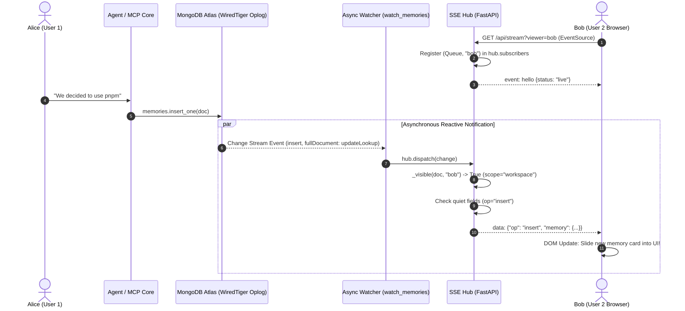

# 06. Real-Time Synchronization via MongoDB Change Streams and Server-Sent Events

---

## 1. Architectural Motivation: Why Polling and WebSockets Were Rejected

In a collaborative multi-agent environment, real-time reactivity is non-negotiable. When Alice tells her agent an architectural constraint, Bob’s browser interface must reflect that memory immediately, without requiring manual page refreshes.

To solve this, TeamBrain evaluates three primary real-time patterns:

### 1.1 Short / Long Polling (Rejected)
- **Mechanism**: The browser sends HTTP requests (e.g., every 1–2 seconds) querying `GET /api/memories?since=<timestamp>`.
- **Failure Modes**:
  - **Severe Database Load**: With 50 connected agents and browser tabs polling every 1 second, the database handles 3,000 queries/minute of idle overhead, burning compute on Atlas clusters.
  - **Inherent Latency Gap**: Events are delayed by up to the polling interval (1–2 seconds).
  - **Battery & Network Drain**: Continuous HTTP connection establishment wastes mobile/laptop bandwidth.

### 1.2 WebSockets (Rejected for this Pipeline)
- **Mechanism**: Bidirectional TCP socket connection maintained between browser and server.
- **Why It is Overkill**:
  - **Bidirectional Mismatch**: Client-to-server messages in TeamBrain are naturally transactional HTTP requests (`POST /api/chat`, `POST /api/memories`). Full duplex communication from client to server is unneeded.
  - **Proxy / Firewall Brittleness**: Corporate firewalls, CDNs, and API gateways frequently terminate or buffer WebSocket upgrade handshakes.
  - **Reconnection Complexity**: WebSockets require custom application-level heartbeat protocols and manual reconnection loops.

### 1.3 Server-Sent Events (SSE) + MongoDB Change Streams (The Selected Architecture)
- **Mechanism**: Unidirectional, long-lived HTTP/1.1 or HTTP/2 stream from server to client with `Content-Type: text/event-stream`.
- **Engineering Advantages**:
  - **Native Browser Resiliency**: Browsers natively implement the `EventSource` API, providing automatic exponential backoff, reconnects, and connection monitoring with zero client-side JavaScript libraries.
  - **HTTP/2 Multiplexing**: SSE operates over standard HTTP, multiplexing seamlessly across existing HTTP/2 connections without port or protocol upgrades.
  - **Oplog-Driven Reactivity**: Instead of the web server manually notifying clients on every write, the server simply listens to MongoDB's distributed replication log (oplog). This cleanly decouples writes from event broadcasts.

---

## 2. How MongoDB Change Streams Work in TeamBrain

MongoDB Change Streams allow applications to access real-time data changes without the complexity or risk of tailing the oplog manually. Change streams use the aggregation framework to filter, transform, and stream documents modified by write operations across a replica set or sharded cluster.



---

## 3. Deep Code Implementation

### 3.1 The Persistent Background Watcher (`app/main.py: watch_memories`)
During FastAPI startup, a long-running asynchronous coroutine is spawned:

```python
async def watch_memories() -> None:
    resume_token = None
    while True:
        try:
            # full_document="updateLookup" ensures updates include the entire post-update document
            async with await memories.watch(full_document="updateLookup", resume_after=resume_token) as stream:
                hub.status = "live"
                log.info("change stream on 'memories' is live")
                async for change in stream:
                    resume_token = change["_id"]  # Store resume token for crash recovery
                    hub.dispatch(change)
        except asyncio.CancelledError:
            raise
        except Exception as e:
            hub.status = f"reconnecting ({type(e).__name__})"
            log.warning("change stream error: %s; retrying in 3s", e)
            resume_token = None
            await asyncio.sleep(3)
```

#### Key Implementation Details:
1. **`full_document="updateLookup"`**: By default, MongoDB update events contain only the delta of changed fields (`updateDescription`). Specifying `updateLookup` instructs Atlas to perform a live document lookup, providing the complete BSON document so clients have the entire payload ready for rendering.
2. **`resume_token` Fault Tolerance**: Every change event includes a high-water mark `_id` token. If network turbulence interrupts the connection, the loop reconnects passing `resume_after=resume_token`, ensuring zero dropped events during reconnection.

---

### 3.2 The In-Memory SSE Hub (`app/main.py: Hub`)

```python
QUIET_FIELDS = {
    "last_accessed_at", "access_count", "last_confirmed_at", 
    "confidence", "reinforced_count"
}

class Hub:
    def __init__(self):
        # Set of active client queues and their viewer authorization: (asyncio.Queue, viewer_id)
        self.subscribers: set[tuple[asyncio.Queue, str]] = set()
        self.status = "starting"

    @staticmethod
    def _visible(doc: dict, viewer: str) -> bool:
        """Enforces tenant boundary and private memory isolation."""
        if doc.get("workspace_id") != config.WORKSPACE_ID:
            return False
        return doc.get("scope") == "workspace" or viewer == "all" or doc.get("owner_id") == viewer

    def dispatch(self, change: dict) -> None:
        op = change["operationType"]
        
        # 1. Handle Hard Deletions
        if op == "delete":
            payload, doc = {"op": "delete", "memory_id": str(change["documentKey"]["_id"])}, None
            
        # 2. Handle Inserts, Updates, and Replacements
        elif op in ("insert", "update", "replace"):
            doc = change.get("fullDocument")
            if not doc:
                return
                
            # Quiet Field Optimization:
            # If an update ONLY changed access_count / last_accessed_at, tag as "touch"
            updated = set((change.get("updateDescription") or {}).get("updatedFields", {}).keys())
            quiet = op == "update" and updated and updated <= QUIET_FIELDS
            payload = {"op": "touch" if quiet else op, "memory": to_json(doc)}
        else:
            return

        # 3. Deliver to Authorized Subscriber Queues
        for queue, viewer in list(self.subscribers):
            if doc is None or self._visible(doc, viewer):
                try:
                    queue.put_nowait(payload)
                except asyncio.QueueFull:
                    pass  # Prevent slow clients from blocking the event loop
```

---

## 4. Architectural Highlights of the Real-Time Engine

### 4.1 The "Quiet Touch" Filter
When an agent generates a response citing `[M1]`, Stage 7 executes `touch()` to increment `access_count` and update `last_accessed_at`. 
- **The Problem**: If every memory citation broadcasted a full `update` event, the front-end would re-render the card, resetting user scroll position and flashing CSS animations while reading.
- **The TeamBrain Solution**: The Hub inspects `updatedFields`. If the update *only* modified quiet fields, it transmits `op: "touch"`. The front-end quietly increments the access badge without triggering DOM re-flow or card animations.

### 4.2 Database-Level Privacy Isolation in Real Time
The Hub enforces authorization *before* delivering events to SSE queues:
```python
def _visible(doc: dict, viewer: str) -> bool:
    if doc.get("workspace_id") != config.WORKSPACE_ID:
        return False
    return doc.get("scope") == "workspace" or viewer == "all" or doc.get("owner_id") == viewer
```
If Alice saves a `scope: "private"` memory (*"I prefer very terse answers"*), Bob’s active SSE connection (`viewer="bob"`) receives nothing. The change stream never leaks private data across subscriber boundaries.

### 4.3 Keep-Alive Heartbeats (`: ping`)
To prevent cloud load balancers (such as AWS ALB, Render, or Cloudflare) from terminating idle SSE connections after 30–60 seconds of inactivity, the streaming generator sends an SSE comment ping every 15 seconds:
```python
try:
    payload = await asyncio.wait_for(queue.get(), timeout=15)
    yield f"data: {json.dumps(payload)}\n\n"
except asyncio.TimeoutError:
    yield ": ping\n\n"  # Lightweight SSE comment keep-alive
```

---

## 5. Front-End Integration (`static/app.js`)

In the browser, real-time synchronization requires only native Web APIs:

```javascript
function connectSSE() {
  const source = new EventSource(`/api/stream?viewer=${encodeURIComponent(state.viewer)}`);
  
  source.onmessage = (event) => {
    const data = JSON.parse(event.data);
    
    if (data.op === "insert") {
      // Add new card, trigger entry animation
      state.memories.set(data.memory._id, data.memory);
      renderMemoryCard(data.memory, { animate: true });
    } else if (data.op === "update") {
      // Update memory content or version strikethrough
      state.memories.set(data.memory._id, data.memory);
      updateMemoryCardDOM(data.memory);
    } else if (data.op === "delete") {
      // Remove from map and DOM
      state.memories.delete(data.memory_id);
      removeMemoryCardDOM(data.memory_id);
    } else if (data.op === "touch") {
      // Quietly increment access counter
      incrementAccessCounter(data.memory._id);
    }
  };
}
```

---

## 6. Document Navigation

- Previous Document: [05. Memory Lifecycle & Advanced Cases](05-memory-lifecycle.md)
- Next Document: [07. API & MCP Server Reference](07-api-and-mcp.md)
- Complete Index: [Table of Contents](../README.md#documentation-index)

